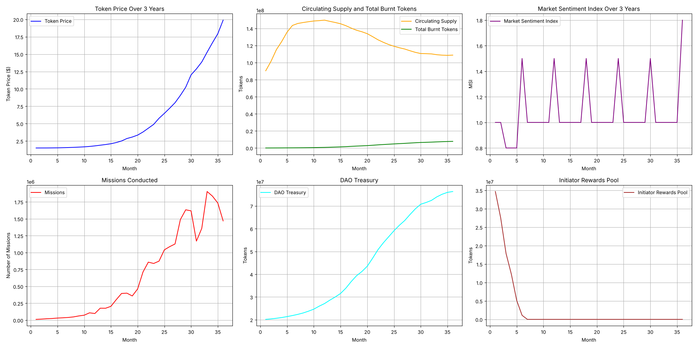
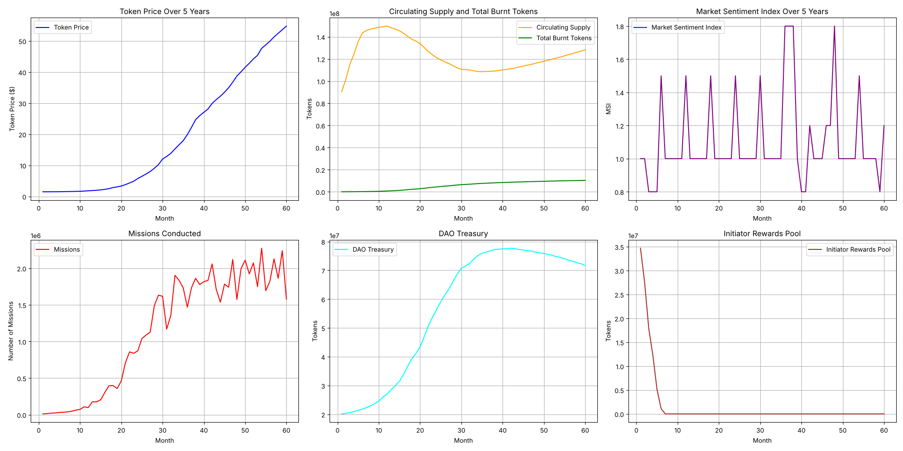
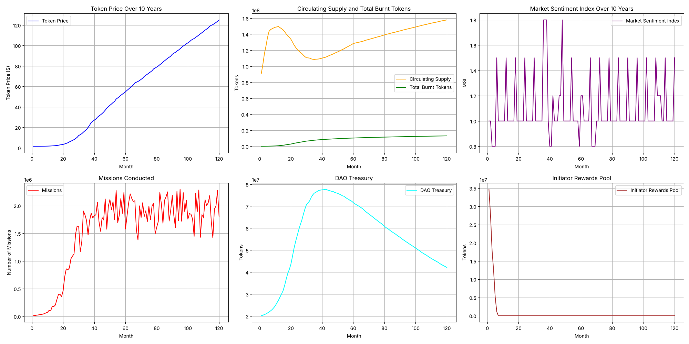

# PoLN Tokenomics Simulation

[](https://github.com/fairhive-labs/tokenomics-simulation/actions/workflows/ci.yml)

A Monte Carlo simulation of the **$POLN** token economy: token price, circulating
supply, burns, staking, mission growth, vesting, DAO treasury and market sentiment,
month by month, over the horizons you choose (3, 5 and 10 years by default).

## Quick start

Requires Python 3.12 or newer.

```bash
git clone https://github.com/fairhive-labs/tokenomics-simulation.git
cd tokenomics-simulation
python -m venv venv && source venv/bin/activate   # Windows: venv\Scripts\activate
pip install -r requirements.txt
python main.py
```

You get a summary in the terminal, plus a CSV and a chart per horizon in `results/`.

## Usage

Every option is optional. Without any, the values in `config.json` are used.

| Option | What it does | Default |
|---|---|---|
| `-y`, `--years N [N ...]` | Horizon(s) to simulate, in years | `simulation_years` in the config |
| `-s`, `--seed N` | Random seed (same seed = same result) | `random_seed` in the config |
| `-c`, `--config PATH` | Use another config file | `config.json` |
| `-o`, `--output DIR` | Where to write CSV and PNG files | `results` |
| `--no-plot` | Skip the charts (CSV and summary only) | off |
| `-h`, `--help` | Show the help | |

Examples:

```bash
python main.py --years 5                  # a single 5-year run
python main.py --seed 7 --output runs/s7  # another random scenario, in its own folder
python main.py -c my-scenario.json        # your own parameters
python main.py --years 1 2 3 --no-plot    # quick runs, data only
```

To explore a scenario, copy `config.json`, change the values (see
[Parameters](#parameters)), and pass it with `-c`. Set `random_seed` to `null`
for a different random run each time. Invalid configs are reported with a clear
error message.

### Outputs

For each horizon `N`, in the output folder:

- `simulation_data_{N}yrs.csv`: one row per month (price, supply, burns, staking,
  missions, DAO treasury, rewards, sentiment, ...)
- `simulation_{N}yrs.png`: 6 charts (token price, supply and burns, market
  sentiment, missions, DAO treasury, initiator rewards pool)

## How it works

Each simulated month:

1. **Missions** grow along a logistic curve, with seasonality and random noise.
2. **Protocol fees** are staked, burnt (on failed missions) or distributed to fellowship members.
3. **Vesting** releases tokens to builders, private-sale investors, testnet partners and initiators (rewards halve as the pool depletes).
4. **Price** moves with net demand vs. supply, market sentiment (bull/bear/normal) and roadmap milestones, capped at ±20% per month.
5. **DAO treasury** is spent at a yearly rate once consumption starts.

## Sample output

### 3 years



### 5 years



### 10 years



## Parameters

All parameters live in [`config.json`](config.json).

### Core Economics

| Parameter | Key | Description |
|---|---|---|
| Total Supply | `total_supply` | Total number of $POLN tokens (200M) |
| Initial Price | `initial_price` | Starting token price in USD |
| Project Cost | `project_cost` | Average mission cost in USD |
| Protocol Fee Rate | `protocol_fee_rate` | Fee percentage charged per mission |
| Staking Rate | `staking_rate` | Fraction of protocol fee staked in $POLN |
| Mission Success Rate | `mission_success_rate` | Probability a mission succeeds |
| Price Elasticity | `pec` | Sensitivity of price to demand/supply ratio changes |
| Random Seed | `random_seed` | Optional integer for reproducible runs. Set to `null` for a nondeterministic (fresh-random) run each time. |

### Market Sentiment

| Parameter | Key | Description |
|---|---|---|
| Bull / Bear / Normal MSI | `msi_bull`, `msi_bear`, `msi_normal` | Sentiment multipliers |
| Bull / Bear Probability | `bull_market_probability`, `bear_market_probability` | Monthly event probability |
| Event Duration | `market_event_duration` | How long market events last (months) |
| Roadmap Effect | `roadmap_effect` | MSI multiplier at roadmap milestones |
| Roadmap Cycle | `roadmap_cycle` | Milestone interval (months) |
| Random Fluctuation | `random_fluctuation` | Mission count noise magnitude |

### Mission Growth

| Parameter | Key | Description |
|---|---|---|
| Carrying Capacity | `carrying_capacity` | Maximum achievable missions |
| Growth Rate | `growth_rate` | Logistic growth speed |
| Inflection Point | `inflection_point` | Month when growth shifts from accelerating to decelerating |
| Seasonality | `seasonality` | Monthly adjustment factors (1-12) |

### Token Distribution

| Parameter | Key | Description |
|---|---|---|
| Distribution | `token_distribution` | Allocation across groups (Public Sales 30%, Initiator Rewards 20%, Private Sales 25%, Builders 10%, DAO Treasury 10%, Testnet 2%, Airdrops 3%) |
| Builders Lockup | `builders_lockup_period` | Months before builders can vest |
| Builders Vesting | `builders_vesting_period` | Linear vesting duration (months) |
| Builders Selling % | `builders_selling_percentage` | Fraction of vested tokens sold monthly |
| Testnet Distribution | `testnet_distribution_period` | Distribution period (years) |
| Initiator Selling % | `initiator_selling_percentage` | Fraction of rewards sold monthly |

### DAO

| Parameter | Key | Description |
|---|---|---|
| Annual Consumption Rate | `dao_annual_consumption_rate` | Yearly treasury drawdown rate |
| Consumption Start | `dao_consumption_start_month` | Month DAO begins spending |
| Fellowship Selling % | `fellowship_selling_percentage` | Fraction of fee distributions sold |

### Private Sales

Array of sale rounds with `tokens_sold`, `price`, and `vesting_period` (months). Example:

```json
[
    {"tokens_sold": 20000000, "price": 0.10, "vesting_period": 12},
    {"tokens_sold": 15000000, "price": 0.20, "vesting_period": 6},
    {"tokens_sold": 15000000, "price": 1.00, "vesting_period": 0}
]
```

### Initiator Rewards

Tiered reward structure with halving mechanics. Initial rewards per mission type:

```json
{"daily": 8.00, "weekly": 64.00, "monthly": 512.00, "quarterly": 4096.00, "half_yearly": 32768.00}
```

Rewards halve as the pool depletes, with a floor at `minimum_reward_per_mission` (1e-18).

## Development

```bash
pip install -r requirements-dev.txt

pytest                             # tests + coverage (must stay at or above 90%)
pylint simulation.py main.py       # lint
bandit -r simulation.py main.py    # security scan
pip-audit -r requirements-dev.txt  # known-vulnerability check on dependencies
```

CI runs the same checks on Python 3.12 and 3.13. Dependabot opens weekly
PRs for Python packages and GitHub Actions, so security fixes land quickly.

## Disclaimer

This is a modelling tool for exploring PoLN tokenomics scenarios. Results are
estimates based on configurable assumptions and random processes. Do not use
them as the sole basis for financial decisions.

## License

[MIT](LICENSE), fairhive-labs. Questions or issues:
[open an issue](https://github.com/fairhive-labs/tokenomics-simulation/issues)
or email <contact@poln.org>.
